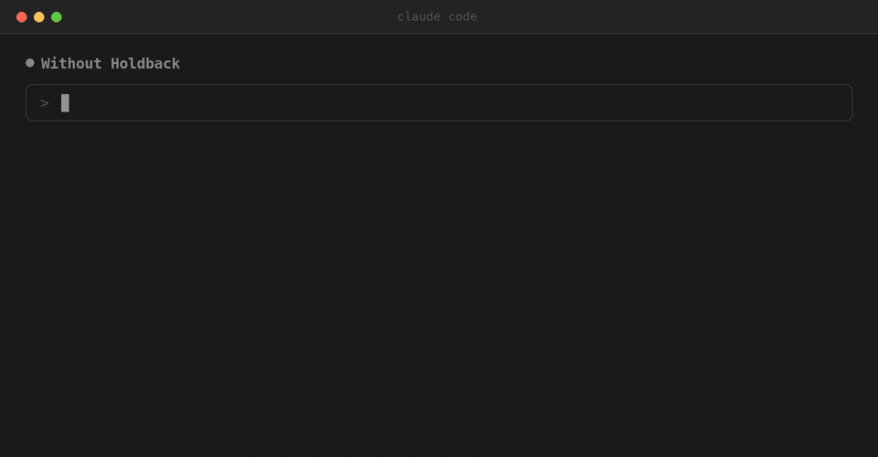

# Holdback

A Claude Code hook. If you ask a question, Claude answers it instead of editing your code.



"Fix the login bug", "can you fix it?", a yes to something Claude offered, or a slash command all let the work through. A question, a critique, a request for a review or a plan, or a passing comment don't. Those get a hold on anything that edits, writes, commits, pushes or deploys. Claude can still read files, search, run `git log` and `git diff`, tests, linters and fetch-only `curl`, and write to the scratchpad and `/tmp`, so the answer is a real one.

I run it next to [Tether](https://github.com/bradley-t-t/tether), which checks Claude's replies before you see them.

macOS and Linux:

```sh
curl -fsSL https://taylorurl.com/holdback | sh
```

Windows, in PowerShell:

```powershell
irm https://taylorurl.com/holdback.ps1 | iex
```

That installs the `holdback` command with pipx or uv, adds two hooks to `~/.claude/settings.json` and leaves your other hooks alone, then runs `holdback doctor`. Nothing goes in system folders and it never needs sudo or administrator rights; start a new Claude Code session afterwards. Needs Python 3.9+ and a signed-in [Claude Code](https://code.claude.com) CLI.

From a checkout instead: clone it and run `python3 holdback.py setup`. `--claude-md` also writes the rule into `~/.claude/CLAUDE.md`, for places that don't run hooks. In a Claude Projects cloud thread, add the marketplace `bradley-t-t/holdback` and the `holdback` plugin under **Project settings > Plugins**. Other cloud environments can run `cloud-setup.sh` from their setup script.

## Reading your message

`UserPromptSubmit` starts judging your message in the background, so the verdict is usually ready by Claude's first tool call. The judge is a second model (`claude -p`, Opus by default). It gets your message, capped at 6,000 characters, and the last 1,500 characters of Claude's previous reply. That tail is there so "yes, do it" counts after an offer and nowhere else. It returns one kind (instruction, request, go-ahead, command, question, critique, remark and a few more) against a JSON schema. Verdicts are cached, last 40 per session. If the judge is down, a regex for instructions, polite requests and go-aheads decides.

Turns you didn't start (CI, background tasks, other sessions) go by your last real request, and so does a bare status check. A subagent goes by the turn that launched it. Headless runs are skipped unless `HOLDBACK=1`.

## Deciding what's a change

`PreToolUse` holds a call only when you didn't ask for work and the call changes something. `changes()` decides the second part:

- `Edit` and `Write` are changes, unless the path is the scratchpad or `/tmp`.
- Bash is parsed with `shlex` through pipes, `&&`, heredocs, `bash -c` and `ssh host '...'`. Known read-only commands pass. A program with no list of its own is resolved on `PATH` and read as the script it is, so your own `check` wrapper is judged by what it actually runs. Anything it still can't read is a change. A wrong guess that way costs a retry. The other way costs your code.
- SQL passes only if every statement is a read, once comments and strings are stripped.
- Other MCP tools are judged by the verb in their name. `get`, `list` and `search` pass, `create`, `send` and `deploy` don't, and no verb means change.

Every hold starts with `Holdback: held` and tells Claude not to hand the task off. Tether and [Baton](https://github.com/bradley-t-t/baton) look for that marker and stay out of it.

## The appeal

Holding everything it can't read is the right default and the wrong answer for `ollama list` or `systeminfo` — a command you only asked a question about, held for nothing. So a command Holdback couldn't read gets one appeal: a second judge is shown the command and the scratchpad directories, nothing else, and asked the one factual question of whether running it would change anything. If it only reads, the call goes through.

The appeal can only ever widen what counts as reading. It never sees a change Holdback did read — `git push`, `rm -rf build`, `npm install`, `sed -i`, a redirect to a real file are held with no judge asked — and a command naming anything that changes things is never appealed, whatever else is in it. It fails closed, so an unreachable, slow or unsure judge leaves the hold in place. And it never sees your message, so it can't decide you probably wanted this. Every appeal is logged with its verdict and whether it was let through. `holdback setup --no-appeal` turns it off.

## Keeping itself current

As each hook finishes, at most once a minute, Holdback starts a background check of the version on `main` — a conditional request, so an unchanged `main` costs GitHub nothing. If `main` is newer it reinstalls with whatever installed it, pipx or uv, or `git pull` for a copy running from a clean checkout. Hooks never wait on it and the next one already runs the new version; on Windows the reinstall starts a few seconds after Holdback exits, since Windows won't replace a running program. A failed check waits five minutes, doubling up to an hour.

`holdback update` does it now, `holdback update --check` only looks, and `holdback doctor` shows the last check.

<details>
<summary>The holdback command</summary>

| Command | What it does |
| --- | --- |
| `holdback setup` | Put the hooks in `~/.claude/settings.json` and keep what you chose |
| `holdback doctor` | Check Python, the judge, the hooks, the settings and the update |
| `holdback status` | Where everything is, as JSON |
| `holdback update` | Bring this copy up to date now |
| `holdback uninstall` | Take the hooks out again (`--purge` its files too, `--all` the command itself) |
| `holdback classify "<message>"` | What the judge makes of one message |
| `holdback changes Bash '{"command": "git push"}'` | What a call would change, or `reads only` |
| `holdback appeal "<command>"` | Whether the appeal judge says a command only reads |
| `holdback selftest` | The saved messages and commands, through the real judges |

</details>

<details>
<summary>Settings</summary>

`holdback setup` keeps these in `~/.config/holdback/config.json` (`%APPDATA%\holdback` on Windows), where the hooks read them. The environment variable wins when it's set.

| Setting | Variable | What it does |
| --- | --- | --- |
| `--model` | `HOLDBACK_MODEL` | Judge model (default `opus`) |
| `--no-appeal` | `HOLDBACK_APPEAL=0` | Hold every command Holdback can't read |
| `--no-update` | `HOLDBACK_UPDATE=0` | Never update itself |
| `--allow-paths` | `HOLDBACK_ALLOW_PATHS` | Extra comma-separated paths Claude can always write to |
| `--claude-md` | | Also write the rule into `~/.claude/CLAUDE.md` |

Environment only:

| Variable | What it does |
| --- | --- |
| `HOLDBACK=0` | Turns Holdback off |
| `HOLDBACK=1` | Also checks headless `claude -p` runs |
| `HOLDBACK_QUESTION` | With `HOLDBACK=1`, your own words to judge |
| `HOLDBACK_STATE` | Where verdicts and the log go (default `~/.local/state/holdback`, `%LOCALAPPDATA%\holdback` on Windows) |
| `HOLDBACK_CONFIG` | Where the settings live |
| `HOLDBACK_OAUTH_TOKEN` | Token for the judge when there's no keychain sign-in (SSH) |
| `HOLDBACK_PLUGIN=1` | Runs the plugin's hooks even when the installed ones are there |

</details>

<details>
<summary>How it's put together</summary>

```
src/holdback/
  system.py      what differs on Windows: paths, processes, locks, the console
  config.py      the settings, read once into one shape
  state.py       the log, and the verdict kept for each message
  judge.py       the two judges and the word scan that stands in for them
  transcript.py  reading a session, and whose words decide a turn
  turn.py        the verdict for the turn a call is made in
  paths.py       where writing changes nothing of yours
  changes.py     what a tool call would change
  shell/         what a shell command would change: parse, programs, code
  hooks/         the Claude Code hooks
  claude/        Holdback's hooks in ~/.claude/settings.json
  package.py     how this copy was installed
  update.py      keeping it current
  cli.py         the holdback command
```

</details>

## Trying it

```sh
holdback classify "can you fix it?"
holdback changes Bash '{"command": "git push"}'
python3 -m unittest discover -s tests -v
holdback selftest   # saved messages and commands through the real judges
```

Built with Python, using only the standard library.
